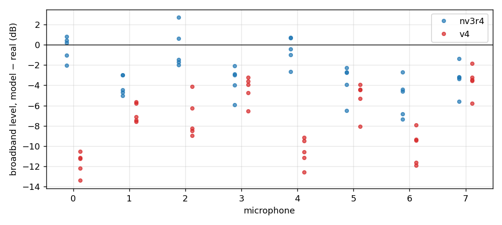
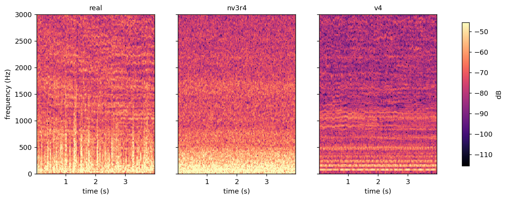

```{=html}
<style>.figure img{max-width:100%} table{font-size:0.92em} audio{width:100%} p code, li code{white-space:normal !important; overflow-wrap:anywhere !important}</style>
```

::: {.callout-note}
This document is written in Simplified Technical English. Sentences are short.
A statement marked INFERENCE is a reading of the data, not a measurement.
:::

# The question

The v4 round-4 bench fit scores badly on DREGON flight:

- HPPNet PIT error: v4 3.51 against nv3r4 1.680.
- LTAS proxy: v4 8.73 dB against nv3r4 2.384 dB.

We had listed four problems of round 4:

- the pedestal width $W$ had no upper bound;
- the pedestal power share had no upper bound;
- the floor exponent $b(f)$ went negative at low frequency;
- the fit did not converge.

Is that list enough to explain the DREGON gap? **No.** This document shows two
more causes, both specific to flight:

1. The v4 bench payload has **no flight wind**.
2. The bench floor is **lower than the flight floor**: it collapsed to
   −140 to −200 dB below 300 Hz.

The round-5 priors fix neither of them. Only a flight stage can fix them: a fit
of the wind and of the floor on flight recordings, with the bench lines held.

# What is compared

- **real**: `DREGON-frames`, room 2, no source. The five scoring windows of
  4 s (free-flight, hovering, updown, rectangle, spinning), 8 mics.
- **nv3r4**: `results/noise_v3/fits_r4/dregon_room2_floor__flight_v3.json`.
  Fitted on five disjoint 8 s flight segments of the same recordings.
- **v4 round 4**: `results/noise_v4/bench/restarts/dregon__kappa0__s3.json`.
  Fitted on the 20 single-rotor bench recordings only.

Both models are rendered with the scorer's renderer and the scorer's carrier
(the measured rotor speeds of each window), render seed 2001, all eight mics.
The spectra are Welch estimates (Hann, 4096 samples, 75 % overlap, 16 kHz).
Script: `scripts/noise_v4_dregon_gap.py flight`, job `nv4-dregon-gap2-8297a3`,
git `d94b41a3`.

# Listen

Window free-flight, mic 0, 4 s each.

```{=html}
<p><b>real</b></p><audio controls src="noise-model-v4-dregon-gap/audio/free-flight_real_mic0.wav"></audio>
<p><b>nv3r4</b></p><audio controls src="noise-model-v4-dregon-gap/audio/free-flight_nv3r4_mic0.wav"></audio>
<p><b>v4 round 4</b></p><audio controls src="noise-model-v4-dregon-gap/audio/free-flight_v4_mic0.wav"></audio>
```

The real recording is a broadband roar with gusts. nv3r4 is a steady roar. v4 is
a quieter set of tones.

# Spectra

{#fig-psd}

Read @fig-psd from left to right:

- **Below 70 Hz.** The real level is about −45 to −48 dB. nv3r4 matches it.
  v4 is at −73 dB, about 25 dB too low.
- **70–600 Hz.** v4 shows separate humps at the first rotor orders (the shaft
  rate is 74–90 rev/s, so about 80, 160 and 240 Hz). The real spectrum has no
  visible humps there: a broadband component 10–20 dB above the v4 lines
  covers them.
- **600 Hz–2 kHz.** v4 is 5–15 dB low.
- **Above 2 kHz.** All three curves are within a few dB.

{#fig-band}

@fig-band gives the same result in numbers. The mic-mean v4 error is:

| Band | v4 round 4 | nv3r4 |
|---|---|---|
| 35–55 Hz | −20 to −23 dB | −2 to +1 dB |
| 111 Hz | about −21 dB | −1 to −4 dB |
| 140 Hz–1.8 kHz | −4 to −14 dB | 0 to −7 dB |
| above 2 kHz | −2 to −6 dB | 0 to −5 dB |

The scorer's LTAS error per window (mean absolute dB over the bands
100–7900 Hz) agrees:

| Window | nv3r4 | v4 round 4 | v4 shape-only |
|---|---|---|---|
| free-flight | 2.90 | 9.38 | 8.87 |
| hovering | 2.34 | 8.79 | 10.09 |
| updown | 3.89 | 10.16 | 10.44 |
| rectangle | 1.35 | 7.31 | 9.89 |
| spinning | 1.44 | 7.99 | 10.00 |

"Shape-only" removes the mean level offset first. The v4 error stays at
9–10 dB, so the problem is the **shape** of the spectrum, not only its level.
The missing power is at low frequency. (Numbers: `figdata_flight.json`,
`windows[*].scorer_*`.)

# Where the v4 power comes from

{#fig-parts}

@fig-parts shows that the v4 render is **lines only**:

- The v4 floor (green) is −140 to −200 dB below 300 Hz and at most −83 dB
  above. It adds nothing audible.
- Between the lines, the v4 level is the skirts of the line pedestals, about
  −80 dB. The real level there is −45 to −60 dB.

Why is the bench floor so low? On the bench, the pedestals fill the gaps between
the lines. The bench likelihood cannot separate "a wide pedestal" from "a
higher floor" there, so the floor is free to go down. The round-5 fits show the
same. Restarts s0 and s2 differ by 84 400 nats (5 × 10⁻⁴ of the total), but
their floors differ by up to 170 dB below 2 kHz: s0 is at −216 dB at 109 Hz,
where s2 is at −46 dB. The floor push $\kappa$ of the spec exists for this
case. Rounds 4 and 5 used $\kappa = 0$.

# Cause 1: no flight wind

In DREGON flight the downwash hits some microphones much more than others.
nv3r4 has a **static per-mic wind** term for it: one level per mic, with a
spectral shape that is flat to 100 Hz, falls 6 dB per octave and is zero above
500 Hz. Its fitted levels are:

| mic | nv3r4 `wind_db` | v4 level error (dB) | nv3r4 level error (dB) |
|---|---|---|---|
| 0 | −5.1 | −11.7 | −0.3 |
| 1 | −6.8 | −6.7 | −4.0 |
| 2 | −12.2 | −7.2 | −0.4 |
| 3 | −37.3 | −4.4 | −3.6 |
| 4 | −5.6 | −10.6 | −0.5 |
| 5 | −22.0 | −5.2 | −3.6 |
| 6 | −18.5 | −10.1 | −5.2 |
| 7 | −44.0 | −3.6 | −3.3 |

The level error is the mean PSD over 31–7900 Hz, model − real, averaged over
the five windows (@fig-mics).

{#fig-mics}

The v4 error follows the wind: the correlation between the v4 level error and
the nv3r4 wind level is **r = −0.80** over the eight mics. The windiest mics
(0 and 4) lose 10–12 dB. The calm mics (3 and 7) lose only 4 dB.

The v4 renderer can already render this term. A payload of kind `flight` reads
`params.wind.wind_db`. A bench payload has none: the bench wind is per
*recording* (it grows with throttle), so it is not a term of the rig. Nothing
in the procedure gives v4 a flight wind for DREGON today.

# Cause 2: the flight floor is higher than the bench floor

The calm mics 3 and 7 have almost no wind (−37 and −44 dB). Their v4 deficit is
still −3.6 to −4.4 dB, and nv3r4 is at −3.3 to −3.6 dB on the same mics.
INFERENCE: the broadband floor in flight is higher than the bench floor. In
flight the four rotors interact, the airframe and the arms are in the
downwash, and the room reflects all four rotors at once. None of these are on
a single-rotor bench.

nv3r4 fitted its floor on flight recordings (mean −38.4 dB, exponent 0.07,
static share 5.5 × 10⁻⁴). v4 takes its floor from the bench only.

# Not the cause: gusts

{#fig-spec}

The real spectrogram (@fig-spec, left) shows vertical stripes below 1 kHz. These
are gusts: short broadband bursts. Neither model has them. nv3r4 is a steady
broadband noise; v4 is a set of steady horizontal lines. The gusts therefore do
not explain the difference between nv3r4 and v4. They are a limit of both
models.

# What follows

The round-5 priors cap $W$ and the pedestal power share, keep $b(f) \ge 0$ and
add the floor push. They correct the bench fit. They do not add a flight wind,
and they do not raise the floor to the flight level. INFERENCE: with the bench
payload alone, v4 cannot reach the nv3r4 DREGON scores.

The fix keeps the model and adds a **DREGON flight stage**, as nv3r4 had:

1. Hold every bench parameter: line profiles, speed laws, pedestal, shaft,
   pair EQ.
2. On the five disjoint 8 s room-2 flight segments of nv3r4 (never the scoring
   windows), fit only:
   - the static per-mic wind `wind_db` (8 values, nv3r4's wind prior);
   - the flight floor: mean level, the 14-point shape, the static share and
     $b(f)$ (the bench floor priors and floor push).
3. Export a v4 payload of kind `flight`. The renderer and the scorer read it
   unchanged.

This is a change of the procedure, not of the model: the wind term and the
floor are already in the v4 model.
