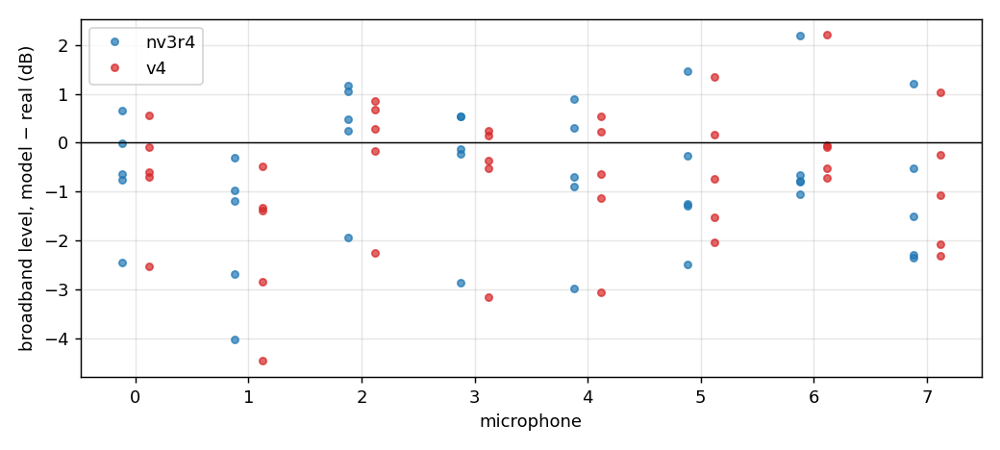

```{=html}
<style>.figure img{max-width:100%} table{font-size:0.92em} audio{width:100%} p code, li code{white-space:normal !important; overflow-wrap:anywhere !important}</style>
```

::: {.callout-note}
This document is written in Simplified Technical English. Sentences are short.
A statement marked INFERENCE is a reading of the data, not a measurement.
:::

::: {.callout-important}
**Update 2026-10-23.** The DREGON flight stage of § "What follows" exists and
converges. It still scores badly. @sec-stage shows why, with the scorer itself:
real vs nv3r4 vs v4 on one window, as spectrograms, the scorer's readout and
audio.
:::

# The question

The v4 round-4 bench fit scores badly on DREGON flight:

- HPPNet PIT error: v4 3.51 against nv3r4 1.680.
- LTAS proxy: v4 8.73 dB against nv3r4 2.384 dB.

We had listed four problems of round 4:

- the pedestal width $W$ had no upper bound;
- the pedestal power share had no upper bound;
- the floor exponent $b(f)$ went negative at low frequency;
- the fit did not converge.

Is that list enough to explain the DREGON gap? **No.** This document shows two
more causes, both specific to flight:

1. The v4 bench payload has **no flight wind**.
2. The bench floor is **lower than the flight floor**: it collapsed to
   −140 to −200 dB below 300 Hz.

The round-5 priors fix neither of them. Only a flight stage can fix them: a fit
of the wind and of the floor on flight recordings, with the bench lines held.

MD2 (Michael's drone) is a different case (@sec-md2). Its v4 fit is a flight
fit, so it has its own flight floor and needs no wind. Its broadband spectrum is
close to the real one. Its failures are local: a standby floor that is too high
below 70 Hz, standby lines that are too weak, and cruise lines that are too wide.
The round-5 priors target exactly these.

# DREGON

## What is compared

- **real**: `DREGON-frames`, room 2, no source. The five scoring windows of
  4 s (free-flight, hovering, updown, rectangle, spinning), 8 mics.
- **nv3r4**: `results/noise_v3/fits_r4/dregon_room2_floor__flight_v3.json`.
  Fitted on five disjoint 8 s flight segments of the same recordings.
- **v4 round 4**: `results/noise_v4/bench/restarts/dregon__kappa0__s3.json`.
  Fitted on the 20 single-rotor bench recordings only.

Both models are rendered with the scorer's renderer and the scorer's carrier
(the measured rotor speeds of each window), render seed 2001, all eight mics.
The spectra are Welch estimates (Hann, 4096 samples, 75 % overlap, 16 kHz).
Script: `scripts/noise_v4_dregon_gap.py flight`, job `nv4-gap-md2-574b70`,
git `24276934`.

## Listen

Window free-flight, mic 0, 4 s each.

```{=html}
<p><b>real</b></p><audio controls src="noise-model-v4-dregon-gap/audio/free-flight_real_mic0.wav"></audio>
<p><b>nv3r4</b></p><audio controls src="noise-model-v4-dregon-gap/audio/free-flight_nv3r4_mic0.wav"></audio>
<p><b>v4 round 4</b></p><audio controls src="noise-model-v4-dregon-gap/audio/free-flight_v4_mic0.wav"></audio>
```

The real recording is a broadband roar with gusts. nv3r4 is a steady roar. v4 is
a quieter set of tones.

## Spectra

{#fig-psd}

Read @fig-psd from left to right:

- **Below 70 Hz.** The real level is about −45 to −48 dB. nv3r4 matches it.
  v4 is at −73 dB, about 25 dB too low.
- **70–600 Hz.** v4 shows separate humps at the first rotor orders (the shaft
  rate is 74–90 rev/s, so about 80, 160 and 240 Hz). The real spectrum has no
  visible humps there: a broadband component 10–20 dB above the v4 lines
  covers them.
- **600 Hz–2 kHz.** v4 is 5–15 dB low.
- **Above 2 kHz.** All three curves are within a few dB.

{#fig-band}

@fig-band gives the same result in numbers. The mic-mean v4 error is:

| Band | v4 round 4 | nv3r4 |
|---|---|---|
| 35–55 Hz | −20 to −23 dB | −2 to +1 dB |
| 111 Hz | about −21 dB | −1 to −4 dB |
| 140 Hz–1.8 kHz | −4 to −14 dB | 0 to −7 dB |
| above 2 kHz | −2 to −6 dB | 0 to −5 dB |

The scorer's LTAS error per window (mean absolute dB over the bands
100–7900 Hz) agrees:

| Window | nv3r4 | v4 round 4 | v4 shape-only |
|---|---|---|---|
| free-flight | 2.90 | 9.38 | 8.87 |
| hovering | 2.34 | 8.79 | 10.09 |
| updown | 3.89 | 10.16 | 10.44 |
| rectangle | 1.35 | 7.31 | 9.89 |
| spinning | 1.44 | 7.99 | 10.00 |

"Shape-only" removes the mean level offset first. The v4 error stays at
9–10 dB, so the problem is the **shape** of the spectrum, not only its level.
The missing power is at low frequency. (Numbers: `figdata_flight.json`,
`windows[*].scorer_*`.)

## Where the v4 power comes from

{#fig-parts}

@fig-parts shows that the v4 render is **lines only**:

- The v4 floor (green) is −140 to −200 dB below 300 Hz and at most −83 dB
  above. It adds nothing audible.
- Between the lines, the v4 level is the skirts of the line pedestals, about
  −80 dB. The real level there is −45 to −60 dB.

Why is the bench floor so low? On the bench, the pedestals fill the gaps between
the lines. The bench likelihood cannot separate "a wide pedestal" from "a
higher floor" there, so the floor is free to go down. The round-5 fits show the
same. Restarts s0 and s2 differ by 84 400 nats (5 × 10⁻⁴ of the total), but
their floors differ by up to 170 dB below 2 kHz: s0 is at −216 dB at 109 Hz,
where s2 is at −46 dB. The floor push $\kappa$ of the spec exists for this
case. Rounds 4 and 5 used $\kappa = 0$.

## The bench fit itself is good on the bench

Is the bench fit simply bad? No. On its own recordings it fits well.
@fig-insample evaluates the round-5 bench fit
(`results/noise_v4/bench/restarts/dregon__kappa0__r5__s2.json`) with the
bench fit's own forward model on six of its 20 recordings: the four motors at
80 % throttle and motor 1 at 50 % and 90 %.

{#fig-insample}

The mean absolute sixth-octave error is 1.6–2.6 dB at 80–90 % throttle and
3.2 dB at 50 %. The error by band is −1.4 to +1.3 dB below 300 Hz, +0.8 to
+1.7 dB at 300 Hz–2 kHz, and −0.9 to +1.5 dB above 2 kHz
(`figdata_insample.json`; job `nv4-insample-r5b-72401b`).

But look at *what* fits the bench. Between 400 Hz and 2 kHz the floor is
55–60 dB below the model total. The broadband level there is made entirely of
line pedestals. Below 150 Hz the floor is 7–17 dB below the total; the rest is
the per-recording bench wind. So the bench data explain the broadband noise
with pedestals and bench wind, and leave the floor almost free. INFERENCE:
this is why the floor wanders between restarts, and why a floor taken from the
bench cannot predict the flight broadband level. The flight stage fits that
level where it is observed.

## Cause 1: no flight wind

In DREGON flight the downwash hits some microphones much more than others.
nv3r4 has a **static per-mic wind** term for it: one level per mic, with a
spectral shape that is flat to 100 Hz, falls 6 dB per octave and is zero above
500 Hz. Its fitted levels are:

| mic | nv3r4 `wind_db` | v4 level error (dB) | nv3r4 level error (dB) |
|---|---|---|---|
| 0 | −5.1 | −11.7 | −0.3 |
| 1 | −6.8 | −6.7 | −4.0 |
| 2 | −12.2 | −7.2 | −0.4 |
| 3 | −37.3 | −4.4 | −3.6 |
| 4 | −5.6 | −10.6 | −0.5 |
| 5 | −22.0 | −5.2 | −3.6 |
| 6 | −18.5 | −10.1 | −5.2 |
| 7 | −44.0 | −3.6 | −3.3 |

The level error is the mean PSD over 31–7900 Hz, model − real, averaged over
the five windows (@fig-mics).

{#fig-mics}

The v4 error follows the wind: the correlation between the v4 level error and
the nv3r4 wind level is **r = −0.80** over the eight mics. The windiest mics
(0 and 4) lose 10–12 dB. The calm mics (3 and 7) lose only 4 dB.

The v4 renderer can already render this term. A payload of kind `flight` reads
`params.wind.wind_db`. A bench payload has none: the bench wind is per
*recording* (it grows with throttle), so it is not a term of the rig. Nothing
in the procedure gives v4 a flight wind for DREGON today.

## Cause 2: the flight floor is higher than the bench floor

The calm mics 3 and 7 have almost no wind (−37 and −44 dB). Their v4 deficit is
still −3.6 to −4.4 dB, and nv3r4 is at −3.3 to −3.6 dB on the same mics.
INFERENCE: the broadband floor in flight is higher than the bench floor. In
flight the four rotors interact, the airframe and the arms are in the
downwash, and the room reflects all four rotors at once. None of these are on
a single-rotor bench.

nv3r4 fitted its floor on flight recordings (mean −38.4 dB, exponent 0.07,
static share 5.5 × 10⁻⁴). v4 takes its floor from the bench only.

## Not the cause: gusts

{#fig-spec}

The real spectrogram (@fig-spec, left) shows vertical stripes below 1 kHz. These
are gusts: short broadband bursts. Neither model has them. nv3r4 is a steady
broadband noise; v4 is a set of steady horizontal lines. The gusts therefore do
not explain the difference between nv3r4 and v4. They are a limit of both
models.

# MD2 (Michael's drone) {#sec-md2}

::: {.callout-note}
Updated 2026-10-23 to the converged round-6 pair. The round-4 joint fit this
section first showed scored standby PIT 36 rev/s (a low-frequency floor that
grew as the rotors slowed, $b(31\,\text{Hz}) = -3.5$, and held 13 Hz odd-order
pedestals); the round-5 priors and the round-6 per-regime pair removed both.
:::

## What is compared

- **real**: `michaels-frames` FLY124, the five 8 s scoring windows of the
  scorer (`gates.MICHAELS_SUPPORTS`): standby at 8 s and 16 s (31–42 rev/s),
  the ramp at 27.68 s (31–99 rev/s), cruise at 40 s and 56 s (67–98 rev/s),
  8 mics.
- **nv3r4**: a per-regime pair,
  `results/noise_v3/fits_r4/michaels_fly125_standby__flight_v3.json` and
  `…_cruise__flight_v3.json`.
- **v4**: the round-6 per-regime pair,
  `results/noise_v4/flight/restarts/md2_fly125_standby_fpb__flight_v4__s0__r6c1.json`
  and `…_cruise_fpb__flight_v4__s0__r6c3.json`, both converged.

Both pairs are fitted on FLY125 and render with `render_noise_regimes`: the
standby fit below 45 rev/s, the cruise fit above 65 rev/s, the power
interpolated between them. FLY124 is a different flight. MD2 has no wind term.

## Scores

| Window | PIT real | PIT nv3r4 | PIT v4 | LTAS nv3r4 (dB) | LTAS v4 (dB) | shape-only nv3r4 | shape-only v4 |
|---|---|---|---|---|---|---|---|
| standby @8 s | 0.40 | 0.40 | 0.35 | 1.01 | 1.00 | 1.00 | 1.58 |
| standby @16 s | 0.29 | 0.34 | 0.37 | 0.72 | 0.73 | 0.71 | 1.11 |
| ramp @27.68 s | 3.17 | 3.60 | 3.31 | 3.65 | 3.97 | 1.39 | 2.47 |
| cruise @40 s | 0.88 | 0.97 | 0.99 | 0.75 | 0.73 | 0.99 | 0.73 |
| cruise @56 s | 0.29 | 0.43 | 0.41 | 2.33 | 2.31 | 1.07 | 1.10 |

PIT (rev/s) is the frozen HPPNet scorer (v4: `nv4-score-md2-r6c3-449bbb`,
seeds 2001–2004; nv3r4: `nv3r4-rescore2-8d6bd9`). Parity ratio 0.481 (nv3r4
0.515); Listen LTAS 0.987 ± 0.054 dB over six seeds (nv3r4 0.975 ± 0.029).

## Listen

Mic 0, the first window of each regime, 8 s each.

```{=html}
<table><tr><th></th><th>real</th><th>nv3r4</th><th>v4 (round-6 pair)</th></tr>
<tr><td>standby</td><td><audio controls src="noise-model-v4-dregon-gap/audio/md2_standby_real_mic0.wav"></audio></td><td><audio controls src="noise-model-v4-dregon-gap/audio/md2_standby_nv3r4_mic0.wav"></audio></td><td><audio controls src="noise-model-v4-dregon-gap/audio/md2_standby_v4_mic0.wav"></audio></td></tr>
<tr><td>ramp</td><td><audio controls src="noise-model-v4-dregon-gap/audio/md2_ramp_real_mic0.wav"></audio></td><td><audio controls src="noise-model-v4-dregon-gap/audio/md2_ramp_nv3r4_mic0.wav"></audio></td><td><audio controls src="noise-model-v4-dregon-gap/audio/md2_ramp_v4_mic0.wav"></audio></td></tr>
<tr><td>cruise</td><td><audio controls src="noise-model-v4-dregon-gap/audio/md2_cruise_real_mic0.wav"></audio></td><td><audio controls src="noise-model-v4-dregon-gap/audio/md2_cruise_nv3r4_mic0.wav"></audio></td><td><audio controls src="noise-model-v4-dregon-gap/audio/md2_cruise_v4_mic0.wav"></audio></td></tr>
</table>
```

## Spectra

{#fig-md2-psd}

{#fig-md2-band}

Mean third-octave error over the eight mics, model − real (dB):

| Window | below 70 Hz nv3r4 | below 70 Hz v4 | 70–300 Hz nv3r4 | 70–300 Hz v4 | above 300 Hz nv3r4 | above 300 Hz v4 |
|---|---|---|---|---|---|---|
| standby @8 s | −4.2 | −4.9 | −1.4 | −2.0 | +0.4 | +0.1 |
| standby @16 s | +3.1 | +2.5 | +0.8 | +0.1 | +0.7 | +0.4 |
| ramp @27.68 s | +0.5 | +0.2 | −1.4 | −1.8 | −4.3 | −4.6 |
| cruise @40 s | −9.9 | −10.1 | −2.6 | −1.9 | −0.2 | −0.4 |
| cruise @56 s | +2.6 | +2.5 | +1.0 | +1.7 | +1.4 | +1.0 |

The two models now make the same band errors to within about 1 dB. Both miss
the cruise @40 s level below 70 Hz by 10 dB and the ramp above 300 Hz by
4–5 dB (neither fit pool contains a ramp; INFERENCE: the broadband noise of a
fast acceleration).

## The floor and the line bases

{#fig-md2-parts}

Two views give different answers, and both matter.

- **At one common rotor speed** (the parameter view below, one 2048-sample
  frame, every rotor at the slider's speed): in **cruise** (80 rev/s) the
  valleys between the lines reach the grey floor from about 200 Hz to 3 kHz:
  the floor sits at the bases of the lines. In **standby** (35 rev/s) it does
  not: the valleys stay near −40 to −45 dB while the floor falls from −45 dB
  at 200 Hz to −65 dB at 1–2 kHz, so it lies 5–20 dB under the bases. The
  standby valleys are carried by the line skirts, i.e. the phase pedestal
  fitted per order (the standby shaft is narrow: $\sigma_\nu \approx 0.36$
  rad/s at 35 rev/s). nv3r4's standby floor does sit at the bases from
  200 Hz to 5 kHz.
- **On the real windows** (@fig-md2-parts: four rotors at different speeds,
  the speeds moving inside the window) the four combs interleave and fill each
  other's valleys. The green floor then lies 10–25 dB below the valleys in
  standby from 30 Hz to 2 kHz, and 5–10 dB below them in cruise at
  250 Hz–2 kHz. The totals still follow the real valleys (@fig-md2-psd).

So in cruise the floor is where it should be; in standby the fit put the
inter-line power into the pedestals instead of the floor. The scores do not
see this, but a standby render has a floor that is too quiet if the lines are
removed. The bench fit shows the same split
(`docs/experiments/noise-model-v4-bench.md` § Round 3).

## Parameters per rotor

Every rotor at the slider's speed: the floor (grey), and the dropdown puts
all rotors, the rotor mean or one rotor's comb on it, with stems at
$k f_r$ and red caps of ± the line half width. v4 first, then nv3r4. The
speed laws of the two halves differ: they are not identified inside a regime
(cruise $\alpha^a$ = 14.05, both $\alpha^m$ at the bound ±4, cruise floor
exponent at the $b \ge 0$ edge), so read each half only inside its own speed
range. Script: `scripts/noise_v4_dregon_gap.py params`.



## Per microphone

{#fig-md2-mics}

The two models now have the same per-mic pattern: within ±1 dB of each other
on every mic and window, −4.4 to +2.2 dB from the real level. There is no mic
pattern like the DREGON wind: MD2 needs no per-mic wind term.

# What follows

**MD2 (outcome, round 6).** The round-5 joint fit still failed standby (PIT
27.8), so MD2 uses the per-regime pair, with the phase pedestal fitted per
order and $|\alpha^m| \le 4$. It passes (@sec-md2).

**DREGON.** The round-5 priors cap $W$ and the pedestal power share, keep
$b(f) \ge 0$ and add the floor push. They correct the bench fit. They do not
add a flight wind, and they do not raise the floor to the flight level.
INFERENCE: with the bench payload alone, v4 cannot reach the nv3r4 DREGON
scores.

The fix keeps the model and adds a **DREGON flight stage**, as nv3r4 had:

1. Hold every bench parameter: line profiles, speed laws, pedestal, shaft,
   pair EQ.
2. On the five disjoint 8 s room-2 flight segments of nv3r4 (never the scoring
   windows), fit only:
   - the static per-mic wind `wind_db` (8 values, nv3r4's wind prior);
   - the flight floor: mean level, the 14-point shape, the static share and
     $b(f)$ (the bench floor priors and floor push).
3. Export a v4 payload of kind `flight`. The renderer and the scorer read it
   unchanged.

This is a change of the procedure, not of the model: the wind term and the
floor are already in the v4 model.

# The DREGON flight stage through the scorer (2026-10-23) {#sec-stage}

## What was fitted, and how it scores

The flight stage (`experiments.noise_model.dregon_flight_v4`, CLI
`scripts/noise_v4_flight.py dregon`) holds the bench lines. On the five 8 s
flight segments it fits the per-mic wind and the flight floor. Options can also
free a gain per rotor, a gain per mic (sum 0), or the line coherence. Every
stage below converged unless marked. The scores use the full protocol: five
windows, render seeds 2001–2004, all 8 mics.

| stage | HPPNet PIT (rev/s) | LTAS proxy (dB) |
|---|---|---|
| nv3r4 (target) | **1.680** | **2.384** |
| v4 stage, no gains (bench κ = 0) | 15.8 | 2.384 |
| + gain per mic | 19.57 | 2.47 |
| + gain per rotor (bench κ = 10) | 61.24 | 2.60 |
| + gain per rotor and per mic | 66.36 | 2.85 |
| + line coherence free (not converged) | 29.4 | 3.20 |

The likelihood pulls the rotor gains down (−4.6 to −14.8 dB), and the scorer
then reads the rotors as off. Freeing the coherence pushes every phase
pedestal to its cap. Raising the shaft wander by hand ($\varepsilon$ 0.02 and
0.05) gives 21.7 and 43.1. No option of the stage comes near 1.680.

## Real vs nv3r4 vs v4 on one window

Window hovering, mics 1 and 2, render seed 2001. Mic 1 is a mic that v4
passes; mic 2 is a mic that v4 fails. "v4 as fitted" is the no-gain stage
(`results/noise_v4/flight/dregon_room2__flight_v4__dregon__kappa0__r5__s2.json`).
"v4, lines +3 dB" is the same payload with both line-profile rows raised by
3 dB. This is a probe, not a fit: it shows what the scorer needs. Script:
`scripts/noise_v4_dregon_gap.py hppnet`, git `a71ade84`.

Scorer error per mic on this window (rev/s):

| arm | mean | m0 | m1 | m2 | m3 | m4 | m5 | m6 | m7 |
|---|---|---|---|---|---|---|---|---|---|
| real | 0.89 | 1.1 | 0.8 | 0.8 | 0.9 | 0.9 | 0.8 | 1.0 | 0.8 |
| nv3r4 | 1.43 | 1.5 | 1.5 | 1.4 | 1.6 | 1.3 | 1.3 | 1.5 | 1.4 |
| v4 as fitted | 22.33 | 3.4 | 4.0 | **80.3** | 2.0 | 3.9 | 1.9 | **80.9** | 2.2 |
| v4, lines +3 dB | 2.01 | 2.1 | 1.9 | 1.6 | 2.3 | 1.9 | 2.2 | 1.9 | 2.2 |

An error of 80 rev/s is the whole rotor speed: the scorer reads every rotor
as off.

{#fig-hpp-spec}

{#fig-hpp-read}

Listen. Each mic has one level scale for all four clips, so the loudness
differences are real.

```{=html}
<table>
<tr><th></th><th>mic 1</th><th>mic 2</th></tr>
<tr><td>real</td><td><audio controls src="noise-model-v4-dregon-gap/audio/hppnet_real_mic1.wav"></audio></td><td><audio controls src="noise-model-v4-dregon-gap/audio/hppnet_real_mic2.wav"></audio></td></tr>
<tr><td>nv3r4</td><td><audio controls src="noise-model-v4-dregon-gap/audio/hppnet_nv3r4_mic1.wav"></audio></td><td><audio controls src="noise-model-v4-dregon-gap/audio/hppnet_nv3r4_mic2.wav"></audio></td></tr>
<tr><td>v4 as fitted</td><td><audio controls src="noise-model-v4-dregon-gap/audio/hppnet_v4_mic1.wav"></audio></td><td><audio controls src="noise-model-v4-dregon-gap/audio/hppnet_v4_mic2.wav"></audio></td></tr>
<tr><td>v4, lines +3 dB</td><td><audio controls src="noise-model-v4-dregon-gap/audio/hppnet_v4_matched_mic1.wav"></audio></td><td><audio controls src="noise-model-v4-dregon-gap/audio/hppnet_v4_matched_mic2.wav"></audio></td></tr>
</table>
```

What the figures show:

- **Real.** Strong gusts below 300 Hz in the first 2 s, then a calm part. The
  k = 1 lines (about 80 Hz) are visible through both.
- **nv3r4.** A steady broadband band below about 180 Hz. Its lines are *less*
  clear than the v4 lines. The scorer still tracks all four rotors.
- **v4 as fitted.** Clear lines at k = 1 and k = 2, and a broadband level 2–3 dB
  below nv3r4 on mic 2 (band levels below). On mic 2 the scorer reads off for
  the whole window.
- **v4, lines +3 dB.** The scorer tracks all rotors on both mics, but with a
  larger error than on nv3r4 (1.6–1.9 against 1.4–1.5 rev/s here).

Band levels on mic 2, this window (Welch, dB):

| arm | 30–60 | 60–120 | 120–250 | 250–500 | 500–1000 Hz |
|---|---|---|---|---|---|
| real | −49.4 | −47.6 | −52.3 | −58.2 | −64.9 |
| nv3r4 | −50.5 | −49.1 | −53.6 | −61.2 | −65.6 |
| v4 as fitted | −52.8 | −50.8 | −56.3 | −63.2 | −66.7 |
| v4, lines +3 dB | −52.8 | −49.2 | −55.1 | −62.4 | −65.7 |

## Cause A: the scorer is level-sensitive, and the scoring windows are louder

The scorer's input is the CQT in absolute dB (`AmplitudeToDB(top_db=80)`), with
no level normalisation. So the absolute level of a render matters, not only its
shape. Probes on the k0 stage (hovering and spinning windows, scorer error on
mics 2 and 6, rev/s):

| probe | hovering m2 | hovering m6 | spinning m2 | spinning m6 |
|---|---|---|---|---|
| v4 as fitted | 80.3 | 80.9 | 56.5 | 11.0 |
| lines +3 dB | 1.6 | 1.9 | 2.0 | 2.3 |
| floor −6 dB | 1.6 | 2.0 | 2.0 | 2.2 |
| floor +3 dB | 80.9 | 80.9 | 80.7 | 9.4 |
| no wind | 1.7 | 1.9 | 2.5 | 2.5 |
| whole render +2 dB | 6.3 | 80.9 | 1.9 | 3.4 |
| nv3r4, +0 dB and +6 dB | 1.4 / 1.4 | 1.5 / 1.5 | 1.5 / 1.5 | 1.5 / 1.5 |

The v4 render sits near a threshold of the scorer: a 2–3 dB change of the
lines, the floor or the whole clip moves mic 2 from "off" to tracked. nv3r4 is
far from that threshold: its error does not change from +0 to +6 dB.

Why is v4 below the threshold? The stage fits the 8 s segments that start 2 s
after each 4 s scoring window. The real recording is louder in the scoring
windows (mean of the five windows, dB):

| | mic 1, 120–250 / 250–500 / 500–1000 Hz | mic 2, same bands |
|---|---|---|
| real, scoring windows minus fit segments | +0.1 / +2.4 / +2.7 | **+3.8 / +5.9 / +4.8** |
| nv3r4 minus real, fit segments | −2.9 / −1.3 / −2.7 | **+3.6 / +3.5 / +4.5** |
| v4 stage minus real, fit segments | −0.0 / +1.2 / +0.3 | +0.7 / +1.6 / +3.2 |
| nv3r4 minus real, scoring windows | −3.0 / −3.6 / −5.7 | −0.4 / −2.4 / −0.5 |
| v4 stage minus real, scoring windows | −0.4 / −1.2 / −2.4 | −3.1 / −4.5 / −1.7 |

On mic 2 the v4 stage is close to its fit data, and nv3r4 is 3.5–4.5 dB above
its fit data. The scoring windows are 4–6 dB louder than the fit segments.
So nv3r4 lands near the real scoring level by its bias, and v4 lands 2–4 dB
below it. INFERENCE: the stage is the better fit of its own data, and that is
exactly why it fails here.

## Cause B: the rotors are harder to tell apart

With the level matched (lines +3 dB), v4 is still worse than nv3r4 on every
mic: 2.01 against 1.43 (hovering) and 2.16 against 1.61 (spinning). The line
shape does not explain it:

| probe, all on lines +3 dB | hovering | spinning |
|---|---|---|
| as is | 2.01 | 2.16 |
| no pedestals | 2.09 | 2.24 |
| no phase pedestal | 4.09 | 2.10 |
| no amplitude pedestal | 2.08 | 2.20 |
| no shaft wander | 1.98 | 2.13 |
| the four rotors' profiles set to their mean | **8.30** | **10.28** |
| nv3r4 | 1.43 | 1.61 |

The scorer has one output map per rotor. It tells the rotors apart by their
harmonic profiles: with four equal profiles it fails. The extra error of v4 is
spread evenly over the four rotors (2.05 / 2.34 / 1.94 / 1.74 against
1.45 / 1.69 / 1.38 / 1.19 on hovering). INFERENCE: the per-rotor profiles that
v4 takes from the single-rotor bench are weaker identity cues than the
profiles nv3r4 fitted in flight.

## What this means

- Cause A is a level shift between the fit segments and the scoring windows.
  A fit that matches its own data better does worse on this scorer. A fit on
  more of each flight (everything outside the scoring windows and their
  guards) would see a level closer to the whole flight.
- Cause B needs the per-rotor line profiles from flight, not from the bench:
  a full DREGON flight fit, as MD2 has.
- With both causes fixed by hand (level matched), v4 is at 2.0–2.2 on these
  two windows. That is still above nv3r4's 1.680 over the five windows.


# Full spectrograms over 8 s {#sec-full}

Each tab is one window: 8 s of the real recording and of each model rendered on
that window's real rotor-speed track (render seed 2001). The frequency axis is
logarithmic, 30 Hz to 8 kHz, so the low orders and the high band show
together. Frames are 128 ms (2048 samples) with a 16 ms hop. Each column
(mic) has one colour scale: the real clip's loudest time-averaged bin + 6 dB
at the top, 70 dB range. The audio below each figure has one level scale per
mic and window, so loudness differences are real. Script:
`scripts/noise_v4_dregon_gap.py full`.

## DREGON

The 8 s start at each 4 s scoring window: the scored 4 s, the 2 s guard, then
the first 2 s of the stage's fit segment. Models: nv3r4; the v4 flight stage as
fitted (no gains, bench κ = 0); the same with its lines +3 dB (the probe of
@sec-stage). Mic 1 passes the scorer for v4; mic 2 fails.



## MD2

The scorer's five 8 s FLY124 windows. Models: the nv3r4 per-regime pair and
the converged v4 per-regime pair (standby
`md2_fly125_standby_fpb__flight_v4__s0__r6c1`, cruise
`md2_fly125_cruise_fpb__flight_v4__s0__r6c3`), both composed by the scorer's
`render_noise_regimes`. Mics 0 and 4.


