```{=html}
<style>
table td, table th, li code, td code { overflow-wrap: anywhere; word-break: break-word; }
audio { width: 230px; }
</style>
```

```{python}
import json
from pathlib import Path

import pandas as pd
from IPython.display import HTML, Markdown
from IPython.display import display as _d

ASSETS = "noise-v4-bench-fit"
IDX = json.loads(Path(f"{ASSETS}/index.json").read_text())
ARMS = {
    "real": "real recording",
    "r3": "R3 fit<br>(Gaussian pedestal render)",
    "r2": "R2 fit<br>(Gaussian pedestal render)",
    "r3_logamp": "R3 fit<br>(library log-amplitude render)",
}


def players(motor):
    rows = IDX["motors"][motor]["settings"]
    out = ["<table style='border-collapse:collapse'><tr><th>setting</th>"]
    out += [f"<th style='padding:4px 8px'>{lab}</th>" for lab in ARMS.values()]
    out.append("</tr>")
    for t, r in rows.items():
        cells = "".join(
            f"<td style='padding:4px 8px;text-align:center'><audio controls preload='metadata' "
            f"src='{ASSETS}/{motor}_{t}_{a}.wav'></audio><br><small>{r['clips'][a]['rms_dbfs']:.1f} dBFS</small></td>"
            for a in ARMS
        )
        out.append(
            f"<tr><td style='padding:4px 8px'><b>{t} %</b><br><small>{r['carrier_rev_s']:.1f} rev/s</small></td>{cells}</tr>"
        )
    out.append("</table>")
    return HTML("".join(out))
```

::: {.callout-note}
## How to read this page

Every figure uses the same colours. **Grey** is the measured data. **Black** is the
R3 fit, the current one. **Red dashed** is the R2 fit, the previous one. R3's
parts: **blue** the steady tone of each harmonic (the *core*), **orange** the noise
band around it (the *pedestal*), **green** the broadband floor, **purple** the
wind on the downwash microphones, **brown** the ambient measured with the rotor
stopped. Spectra are the mean over the microphones that are out of the downwash.
Assets: `docs/explainers/noise-v4-bench-fit/build.py`; campaign log:
`docs/experiments/noise-model-v4-bench.md` § Round 2, Round 3.
:::

## 1. What was fitted

**The data.** On the DREGON bench one motor spins at a fixed throttle while the
8-microphone array records. There is one recording per throttle setting, 50, 60,
70, 80 and 90 %, i.e. 49 to 88 rev/s, each 10–36 s long. The fit reads one
high-resolution spectrum per recording and microphone (0.03–0.1 Hz bins,
30 Hz–7.2 kHz). One fit covers all five recordings of a motor at once.

**The model** says the spectrum of a recording is a sum of five things:

| part | what it is physically | what it looks like in a spectrum |
|---|---|---|
| harmonic core (blue) | the steady tone at each multiple *k* of the rotor speed *f<sub>r</sub>* | a sharp peak at *k f<sub>r</sub>*, blurred only by the slow wander of the shaft speed |
| harmonic pedestal (orange) | the part of harmonic *k* whose phase and amplitude jitter; a share 1 − e<sup>−σ²<sub>k</sub></sup> of its power | a bump of half-width γ<sub>k</sub> Hz centred on *k f<sub>r</sub>* |
| motor lines | the electrical tones at *k* = 21, 42, 63 … (7 pole pairs × 3) | extra sharp peaks at those orders |
| floor (green) | broadband rotor noise, one smooth spectrum per motor that grows with speed | a smooth curve under everything |
| wind (purple) and ambient (brown) | downwash on mics near the rotor; the room with the rotor stopped (measured, not fitted) | smooth curves at low frequency / far below |

The level of every harmonic follows a speed law, plus a per-microphone,
per-recording scatter. The shaft speed wanders as an Ornstein–Uhlenbeck
process with rms σ<sub>ν</sub> and rate λ, one law per motor across the five
speeds.

**Two fits per motor.** **R2** caps the pedestal at σ² ≤ 0.6, so at least 55 % of
every harmonic must be a steady tone. **R3** removes that cap. Both fit the
same data with the same likelihood.

```{python}
rows = []
for motor, r in IDX["motors"].items():
    for arm, v in r["fits"].items():
        sh = v["shaft"]
        rows.append({
            "motor": motor,
            "fit": arm.upper(),
            "objective (nats)": f"{v['total_nats']:,.0f}",
            "converged": "yes" if v["converged"] else f"no ({v['restart_gain_per_cell']:.1e}/cell)",
            "speed jitter ε at 80 rev/s": f"{100 * sh['eps']:.2f} %",
            "shaft rate λ at 80 rev/s (1/s)": f"{sh['lam_ref_per_s']:.0f}",
            "line speed exponent α": f"{v['alpha_aero']:.2f}",
        })
_d(HTML(pd.DataFrame(rows).to_html(index=False)))
```

Lower objective is better. R3 is 72 k nats better than R2 on Motor1 and 44 k on
Motor3. Motor1 R3 and Motor3 R2 did not pass the convergence test (a fresh
optimiser restart still gains more than 10⁻⁴ nats per cell).

## 2. Listen

Microphone 0 (out of the downwash), the same 6 s from the middle of each
recording. **One gain per setting** puts the real clip's peak at −6 dBFS and is
applied unchanged to the renders, so loudness differences are real. The number
under each player is the clip's rms level.

The renders are draws from the fitted model, not resyntheses of the recording:
same spectrum in expectation, independent random phases.

- **Gaussian pedestal render** (columns 2–3): each harmonic is a steady tone of
  power P e<sup>−σ²</sup> plus a Gaussian noise band of power P (1 − e<sup>−σ²</sup>)
  with exactly the fitted pedestal shape, all riding on one simulated shaft. It
  was written for this page (`render_gaussian` in `build.py`) and reproduces the
  fitted long-term spectrum within 0.46–0.63 dB (§3).
- **Library log-amplitude render** (column 4): `bench_v4.render_setting`, the
  renderer the explainer prescribes (`noise-model-v4.qmd` § am-pm, decision of
  2026-10-02), which turns the pedestal into a slow random amplitude. With R3's
  σ² of 0.5–80 at high orders, that amplitude spends most of the time near zero
  and occasionally bursts: isolated bright spots in the bottom spectrogram row.
  It misses the fitted spectrum by 1.8–2.6 dB. It is included to show why the
  renderer has to change before the R3 fit is used.

### Motor1

```{python}
players("Motor1")
```

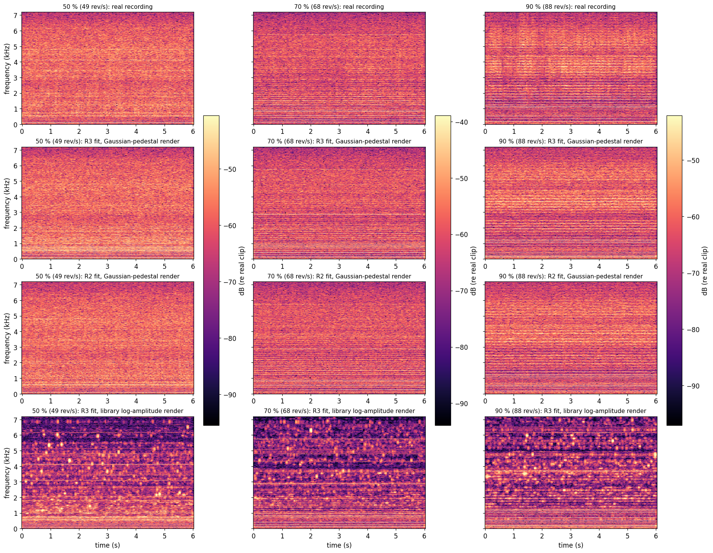

### Motor3

```{python}
players("Motor3")
```

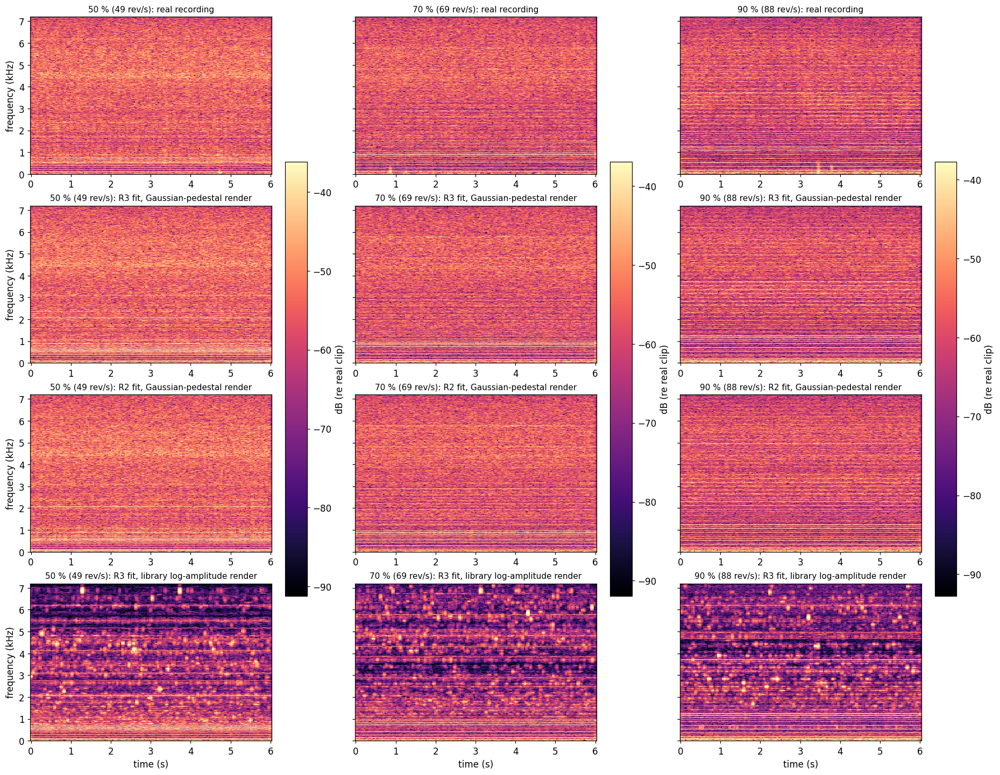

### How much the harmonics flicker

The frame-to-frame standard deviation of each harmonic's level, from 64 ms
frames on microphone 0 (median over the orders of the group). A perfectly steady
tone gives 0 dB. Pure noise in the bin gives 5.6 dB.

```{python}
rows = []
for motor, r in IDX["motors"].items():
    for t, v in r["settings"].items():
        for a, lab in ARMS.items():
            fl = v["flicker_db"][a]
            rows.append({"motor": motor, "setting": f"{t} %", "clip": lab.replace("<br>", " "),
                         "k = 1–4": f"{fl['k1-4']:.1f}", "k = 10–20": f"{fl['k10-20']:.1f}",
                         "k = 40–80": f"{fl['k40-80']:.1f}"})
_d(HTML(pd.DataFrame(rows).to_html(index=False)))
```

- At k = 40–80 the real harmonics are already pure noise (5.5–5.8 dB). Both
  Gaussian renders match (5.1–5.7). The library renderer overshoots (8.1–9.1).
- At k = 10–20 the real harmonics flicker 4.3–5.5 dB. The renders flicker less:
  R3 3.1–4.9, R2 2.9–3.9.
- At k = 1–4 the real harmonics flicker 2.4–5.0 dB, the renders 1.6–3.5. The low
  harmonics of the real rotor are less steady than either fit makes them.

## 3. The spectrum

### Long-term spectrum

The 1/24-octave mean of the spectrum. The bottom row is data minus model. A
render that reproduces its model sits on 0 (solid cyan for the Gaussian render,
dotted for the library one).

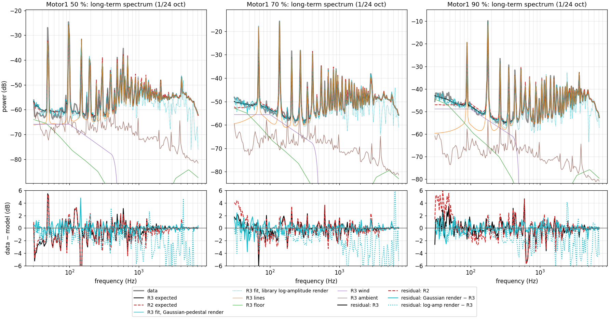

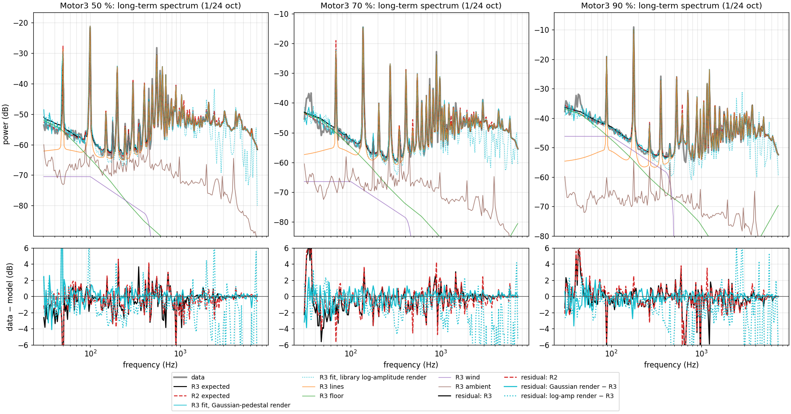

```{python}
rows = []
for motor, r in IDX["motors"].items():
    for t, v in r["settings"].items():
        rows.append({"motor": motor, "setting": f"{t} %",
                     "|data − R3| (dB)": f"{v['ltas_mean_abs_db']['r3']:.2f}",
                     "|data − R2| (dB)": f"{v['ltas_mean_abs_db']['r2']:.2f}",
                     "|Gaussian render − R3| (dB)": f"{v['render_vs_expected_ltas_mean_abs_db']['r3']:.2f}",
                     "|library render − R3| (dB)": f"{v['render_vs_expected_ltas_mean_abs_db']['r3_logamp']:.2f}"})
_d(HTML(pd.DataFrame(rows).to_html(index=False)))
```

Both fits reproduce the long-term spectrum to about 1 dB on average. The visible
misses are a few low harmonics (Motor1 50 %: +5 dB at the first harmonic) and the
lowest 30–60 Hz at 90 %, where R2 is 4–6 dB low.

### Zoom: three groups of harmonics at full resolution

Each panel is 4 harmonics wide: orders 1–4, 16–19, and 60–63. The data are
smoothed over 5 bins (0.15–0.5 Hz). These are the panels to look at to see what
the core and the pedestal each do.

::: {.panel-tabset}

#### Motor1 50 %
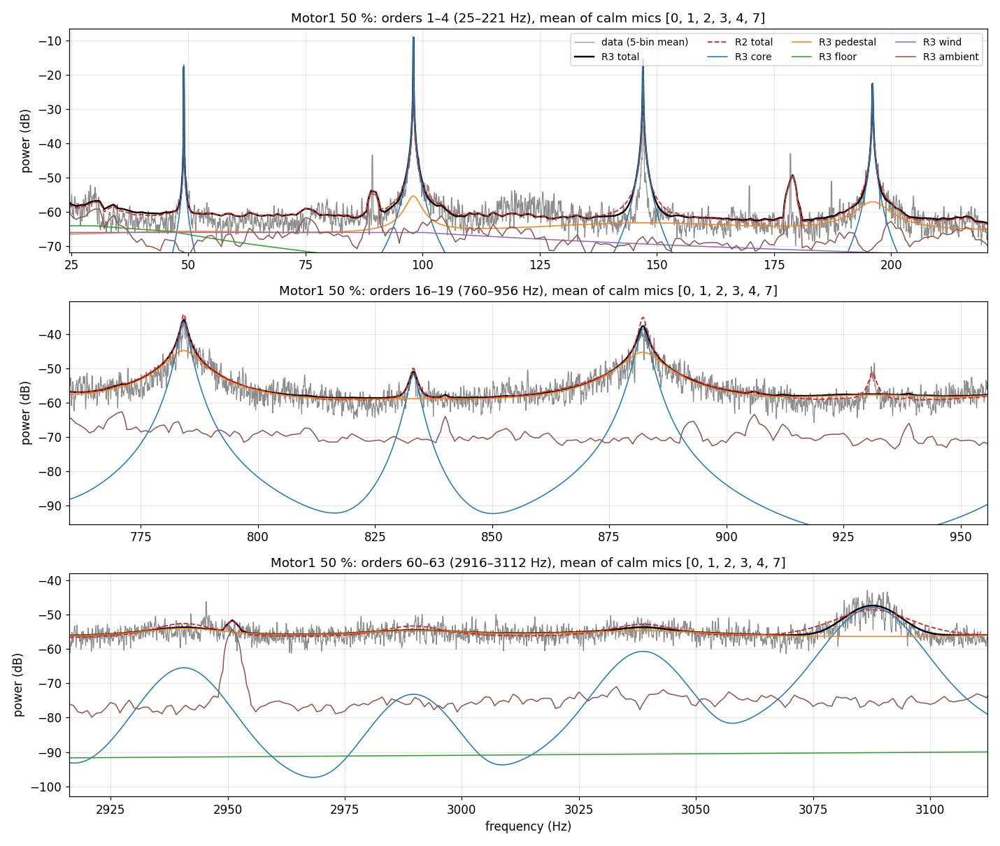

#### Motor1 70 %
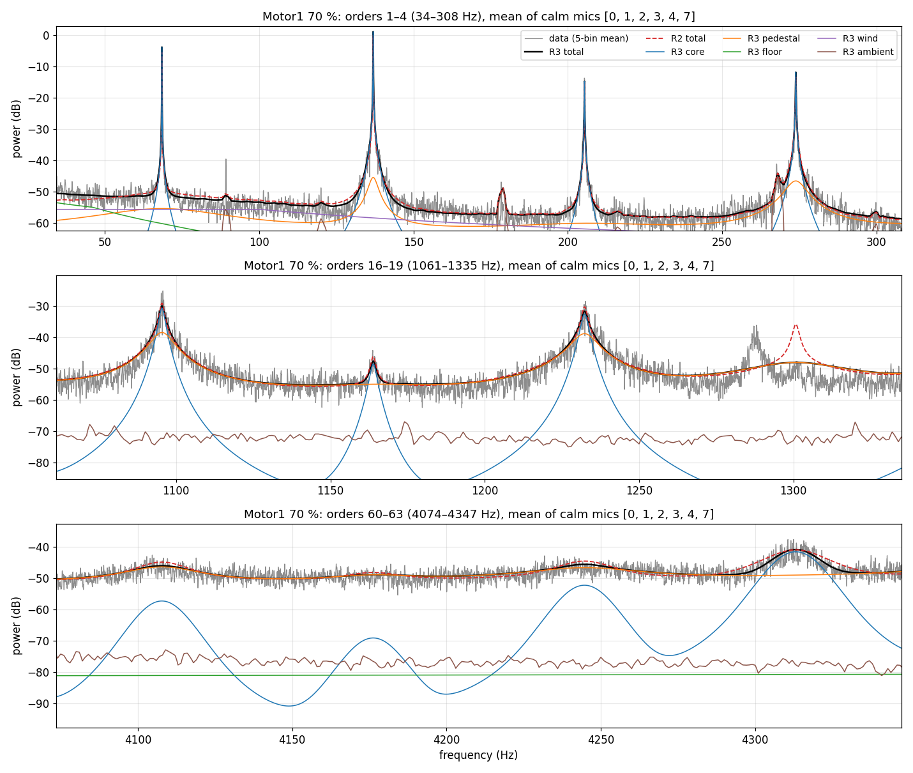

#### Motor1 90 %
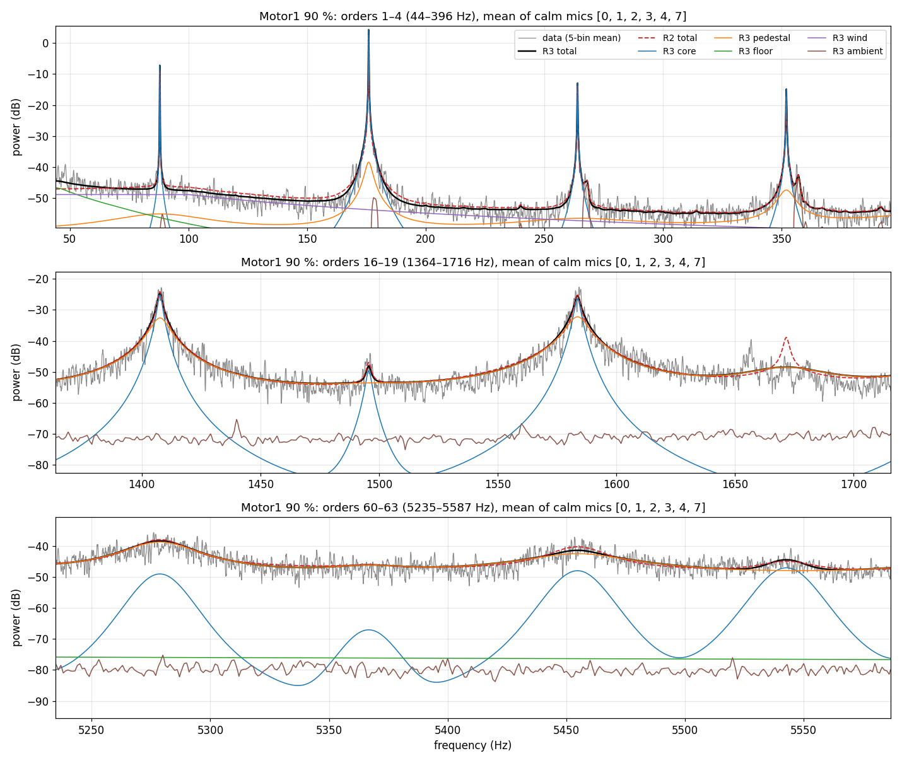

#### Motor3 50 %
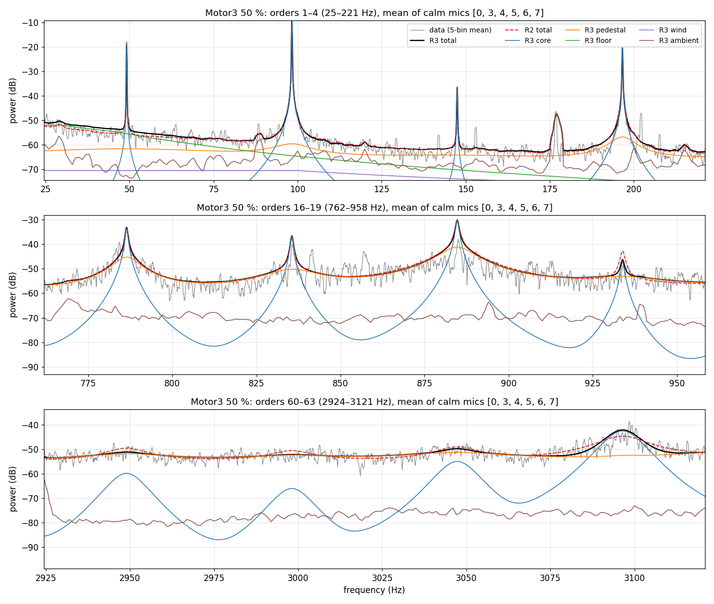

#### Motor3 70 %
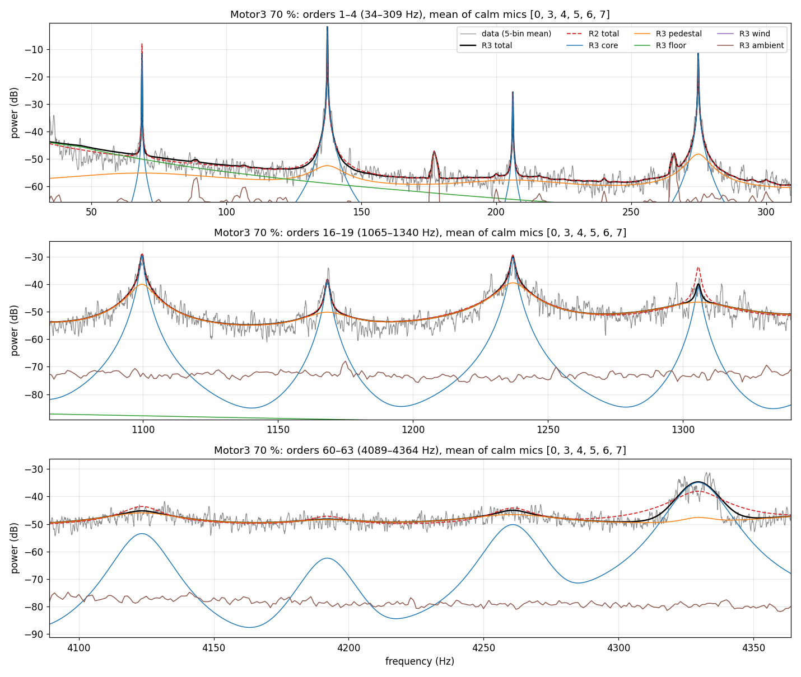

#### Motor3 90 %
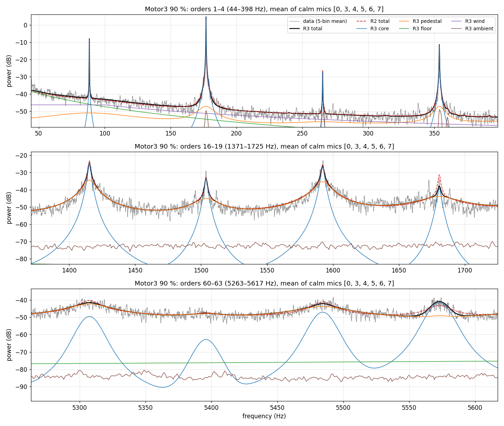

:::

What the zooms show:

- **Orders 1–4** are tones. The blue core carries the peak, and the orange
  pedestal sits 30–45 dB under the peak.
- **Orders 16–19** have a narrow tip on a wide skirt. The core makes the tip. The
  pedestal (half-width 2.6–4 Hz on most of these orders) makes the skirt, which falls 20–25 dB by the
  midpoint between harmonics. That is how R3 explains the power between the
  lines. R2 was not allowed this pedestal, so it made the same skirt with a
  fast-wandering shaft: λ = 61–107 1/s on Motor1 and 12 000–22 000 1/s on
  Motor3, against R3's 12–32.
- **Orders 60–63** are no longer tones. The data are a bump of a few dB on a
  continuum, and R3 makes most of it from the pedestal, with the core 0–15 dB
  below.
- **A tone the model does not have.** Motor1 70 % has a peak at 1288 Hz and 90 %
  one at 1656 Hz. Both are at order 18.82, not an integer, so the peak moves with
  the speed. There is another at order 22.55 (1544 Hz at 70 %, 1324 Hz at 60 %).
  The model only knows integer orders. R3 smears the power with a huge pedestal
  on order 19 (σ²<sub>19</sub> = 80, the spike in §5), and one on order 57
  (σ² = 37), next to 3 × 18.82 = 56.5. R2 draws a peak at 19 *f<sub>r</sub>* where the
  data has none. These are probably bearing or motor tones; that is an
  inference, nothing here measures it.

## 4. Between the lines

The spectrum folded onto the distance from the nearest harmonic,
|f − k f<sub>r</sub>|: left of each panel is on a harmonic, right is midway
between two. One row per frequency band, one column per setting.

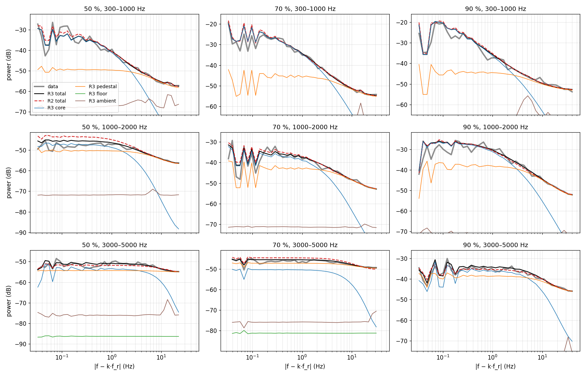

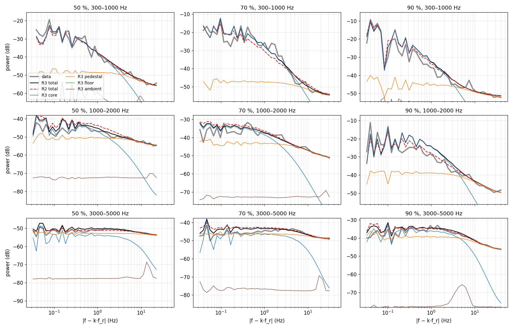

- At 0.3–2 kHz the data fall continuously from the harmonic to the midpoint, by
  10–35 dB. There is no flat part. R3 follows the fall with core then pedestal.
- At 3–5 kHz the data are nearly flat at 50 and 70 % (within 5 dB) and fall about
  15 dB at 90 %: the pedestals of neighbouring harmonics overlap and fill the gap.
- The green floor stays at least 30 dB under the data. R3 puts nothing
  broadband under the harmonics above 400 Hz.

**This does not prove there is no broadband floor.** The fit cannot tell a
broadband floor sitting a few dB under the midpoint level from the pedestals'
tails. The data bound the floor from above (the midpoint level, −51 to −57 dB at
0.4–2 kHz on Motor1). They do not bound it from below. The last panel of §5 shows
the same thing over frequency for all five settings.

## 5. The fitted parameters

### Interactive view

The same design as the rig parameter view of `notebooks/prior_rigs_explainer.ipynb`
(`noise_lab.rig_view_plotly`). Use the dropdown to pick a motor and a fit, and
the slider to pick a throttle setting. Grey is the data, black the fit's
expected periodogram. The fit is split into the steady tones (blue), the
pedestals (orange), the floor (green) and the measured ambient (brown). The
stems run from the floor to the line level at k·f<sub>r</sub>. The red caps are
± the pedestal half-width γ<sub>k</sub>. Hover over a stem top to read k, σ²<sub>k</sub>
and γ<sub>k</sub>. All curves are means over 3 Hz bins on the calm mics, so the
sharp line peaks read lower than at full resolution. Built by
`noise-v4-bench-fit/browser.py`.

```{python}
import numpy as np
import plotly.graph_objects as go

BR = json.loads(Path(f"{ASSETS}/browser.json").read_text())
fx = BR["freqs"]
STY = [
    ("data", dict(mode="lines", line=dict(color="rgba(120,120,120,0.8)", width=1))),
    ("total", dict(mode="lines", line=dict(color="black", width=1.2))),
    ("core", dict(mode="lines", line=dict(color="#1f77b4", width=1))),
    ("pedestal", dict(mode="lines", line=dict(color="#ff7f0e", width=1))),
    ("floor", dict(mode="lines", line=dict(color="#2ca02c", width=1.5))),
    ("ambient", dict(mode="lines", line=dict(color="#8c564b", width=1))),
]


def step_traces(st):
    out = [(fx, st["curves"][n]) for n, _ in STY]
    fk, lv, fl = np.array(st["fk"]), np.array(st["line_db"]), np.array(st["floor_db"])
    nan = np.full(fk.size, np.nan)
    out.append((np.column_stack([fk, fk, nan]).ravel(), np.column_stack([fl, lv, nan]).ravel()))
    g = np.array(st["gamma"])
    out.append((np.column_stack([fk - g, fk + g, nan]).ravel(), np.column_stack([lv, lv, nan]).ravel()))
    return out


def hover(st):
    return [f"k={k} σ²={s:.2f} γ={g:.1f} Hz" for k, s, g in zip(range(1, len(st["fk"]) + 1), st["sigma2"], st["gamma"])]


n_steps = len(BR["views"][0]["steps"])
fig = go.Figure()
per_view = 8
for vi, view in enumerate(BR["views"]):
    st = view["steps"][2]
    for (x, y), (name, style) in zip(step_traces(st)[:6], STY):
        fig.add_trace(go.Scatter(x=x, y=y, name=name, visible=vi == 0, legendgroup=name, showlegend=vi == 0, **style))
    (sx, sy), (cx, cy) = step_traces(st)[6:]
    fig.add_trace(go.Scatter(x=sx, y=sy, name="line level at k·f_r", mode="lines", visible=vi == 0,
                             line=dict(color="#1f77b4", width=1.5), showlegend=vi == 0, hoverinfo="skip"))
    fig.add_trace(go.Scatter(x=cx, y=cy, name="± pedestal half-width γ_k", mode="lines", visible=vi == 0,
                             line=dict(color="#d62728", width=2.5), showlegend=vi == 0, hoverinfo="skip"))

# hover markers on the stem tops: one trace per view, updated by the slider
for vi, view in enumerate(BR["views"]):
    st = view["steps"][2]
    fig.add_trace(go.Scatter(x=st["fk"], y=st["line_db"], mode="markers", marker=dict(size=4, color="#1f77b4"),
                             text=hover(st), hoverinfo="text", visible=vi == 0, showlegend=False))
n_views = len(BR["views"])
n_main = per_view * n_views


def visible(vi):
    return [i // per_view == vi for i in range(n_main)] + [i == vi for i in range(n_views)]


steps = []
for j in range(n_steps):
    xs, ys, texts = [], [], []
    for view in BR["views"]:
        for x, y in step_traces(view["steps"][j]):
            xs.append(x); ys.append(y); texts.append(None)
    for view in BR["views"]:
        st = view["steps"][j]
        xs.append(st["fk"]); ys.append(st["line_db"]); texts.append(hover(st))
    s0 = BR["views"][0]["steps"][j]
    steps.append(dict(method="restyle", label=f"{s0['throttle']} %",
                      args=[{"x": xs, "y": ys, "text": texts}, list(range(n_main + n_views))]))

fig.update_layout(
    xaxis=dict(title="frequency (Hz)", type="log", range=[np.log10(30), np.log10(7200)]),
    yaxis=dict(title="power, calm-mic mean, 3 Hz bins (dB)", range=[-95, 0]),
    sliders=[dict(active=2, steps=steps, currentvalue=dict(prefix="throttle: "), pad=dict(t=50))],
    updatemenus=[dict(buttons=[dict(method="restyle", label=v["label"], args=[{"visible": visible(i)}])
                               for i, v in enumerate(BR["views"])],
                      x=0.0, xanchor="left", y=1.12, yanchor="bottom")],
    legend=dict(orientation="h", x=0.0, y=-0.35, yanchor="top"),
    margin=dict(t=80, b=40), height=700,
)
HTML(fig.to_html(include_plotlyjs=True, full_html=False))
```


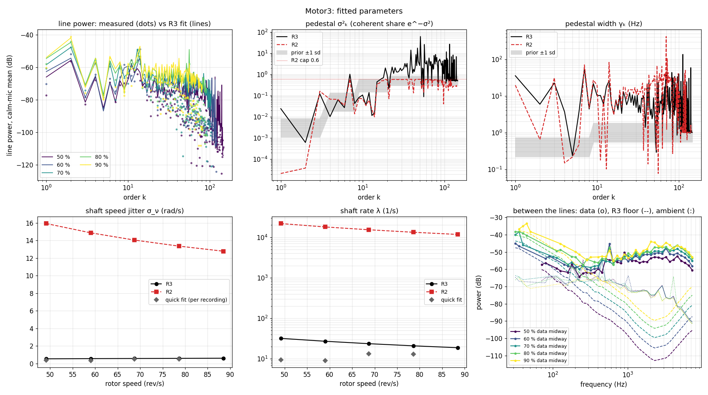

- **Harmonic levels.** The fit follows the measured levels to order ≈ 30. Above
  that the measured dots scatter 20–30 dB below the fitted lines. There the
  harmonics have no peak left to measure, so the dots are not a level estimate.
- **σ²ₖ.** R3 rises from 0.001–0.01 at k ≤ 3 to a median of 2.6–2.8 above
  k = 30 (10–90 %: 0.5–6.5). So above k = 30 the median harmonic keeps about 6 %
  of its power in the tone. The isolated spikes (Motor1 k = 19 at 80, k = 57 at
  37; Motor3 k = 51 at 61) mark power the model cannot place at an integer order,
  as in §3, not a property of those harmonics. R2 sits on its cap from k ≈ 15.
- **Pedestal width γₖ.** Median 4–7 Hz above k = 30 (10–90 %: 1–35 Hz), against
  a prior centred at 1 Hz.
- **Shaft.** R3's speed jitter (0.5–0.8 rad/s) and rate (12–32 1/s) sit near the
  per-recording quick fit. R2's rate is 61–107 1/s on Motor1 and 12 000–22 000 on
  Motor3: there the shaft was standing in for the missing pedestal.
- **Floor.** Below ≈ 100 Hz the R3 floor follows the data between the lines.
  Above that it drops 10–50 dB under it. That is the non-identifiability of §4,
  not a measurement of the floor.

## 6. What the result means

1. **The model reproduces the measured spectrum** of a single rotor at five
   speeds to about 1 dB on average. Both fits do. The difference between them
   is how they build the power around each harmonic.
2. **A DREGON harmonic is a tone at low order and a noise band at high order.**
   Up to k ≈ 10 (below ≈ 700 Hz) most of the power is a steady tone on a slowly
   wandering shaft. Above k ≈ 30 (above ≈ 2 kHz) most of it is a noise band a
   few Hz wide (median half-width 4–7 Hz) around k f<sub>r</sub>. The flicker
   statistics agree: at k = 40–80 the real harmonics and both Gaussian renders
   are equally noise-like (5.1–5.8 dB).
3. **The current renderer cannot play R3.** It turns the noise band into a
   random amplitude, which for σ² ≫ 1 gives bursts and misses the spectrum by
   ~2 dB. The Gaussian pedestal render on this page reproduces the fit within
   0.46–0.63 dB.
4. **Three things the fit does not get right:**
   - speed-locked tones at non-integer orders (18.82, 22.55), absorbed by
     inflating single pedestals;
   - low harmonics that fluctuate more in reality than in the model (flicker
     2.4–5.0 dB against 1.6–3.5);
   - a broadband floor above 400 Hz that these recordings cannot pin down.
5. **Not yet converged.** The Motor1 R3 fit still gains about 2 × 10⁻⁴ nats per
   cell on restart. Only Motor1 and Motor3 have an R3 fit.
