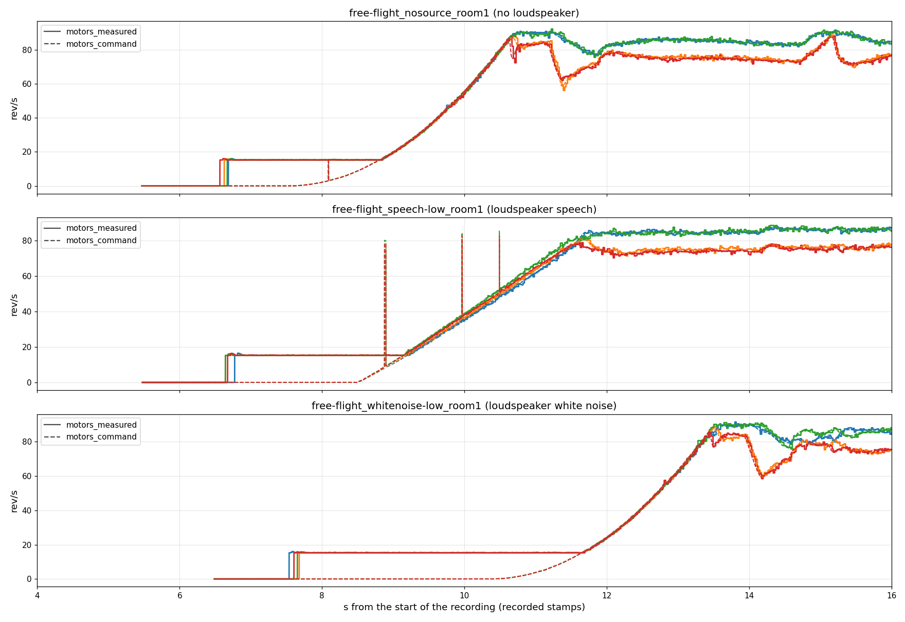

```{python}
import json
from pathlib import Path

here = Path("synthetic-transfer-failures")
index = json.loads((here / "index.json").read_text())


def table(rows, cols, heads=None, fmt="{:.2f}"):
    """Markdown table; ``cols`` are row keys, numbers through ``fmt``."""
    def cell(v):
        if v is None or (isinstance(v, float) and v != v):
            return "—"
        return fmt.format(v) if isinstance(v, float) else str(v)
    out = ["| " + " | ".join(heads or cols) + " |", "|" + "---|" * len(cols)]
    out += ["| " + " | ".join(cell(r.get(c)) for c in cols) + " |" for r in rows]
    return "\n".join(out)
```

## In short

- **The DREGON labels at the start of each recording are wrong in time.** The
  telemetry begins 5.5–6.5 s after the audio. The panel cut its first 8 s clip
  from the audio start anyway, stored the 1.5–2.5 s of telemetry that falls in
  the clip as an untimed array, and the loader stretched that array over the
  whole 8 s. The motors therefore switch to idle 2.5–3 s too early in the
  label, while the audio is still silent. Later clips are within ±0.09 s.
- **Every DREGON "zero" frame of the panel lies before the first telemetry
  sample**, and half of its "standby" frames are not idle at the telemetry's
  own time. With labels placed at their recorded stamps, prior_v1's DREGON
  error falls from 8.09 to 5.83 and nv3r4's from 5.22 to 5.17.
- **Training labels are not stretched**, because the online mixer reads the
  telemetry by time. But the rp streams' DREGON material (the five room-2
  flights) carries only the *command* track, and the command has no idle. The
  armed rotors, audible for about 1.2–1.5 s per flight before the command
  reaches 15 rev/s, are labelled 0 or as a slow spin-up from 0. So the
  training stream contains no correctly labelled DREGON idle.
- **prior_v1 rarely makes octave errors.** It fails in three other ways:
  - it invents rotors under loudspeaker white noise and reads the room's 85 Hz
    tone as a 43 rev/s rotor;
  - it predicts "off" for MD2's low-speed rotors (31–41 rev/s), which are
    clearly audible;
  - it cannot hear DREGON idle (15.3 rev/s), and nv3r4 hardly can either.
- Cruise is fine for both models.

Every figure below has its audio next to it. Each WAV is normalised to the same
RMS (−26 dBFS), so loudness is not comparable between clips. The DREGON WAVs
are microphone 0 (or the mic named in the title), resampled to 16 kHz as the
models hear them.

## Panel scores

Mean absolute error in rev/s on `rp-real-valid-v1`: 52 clips × 8 microphones =
416 mono items of 8 s. DREGON is the three room-1 free flights; MD2 is FLY124,
raw and mixed with speech. A regime is a property of the label frame: *zero*
< 1 rev/s, *ramp* slew > 20 rev/s², *standby* mean < 45 rev/s, and *cruise*
everything else. Scores come from `results/rp_panel_eval/synthetic.json`
(`scripts/rp_panel_eval.py`, job `rp-panel-synth-262144`).

```{python}
#| output: asis
names = {
    "prior_v1_hppnet_l2:best_real_overall": "prior_v1 HPPNet-L2",
    "nv3r4_hard_legacytraj_hppnet_l2:best_real_overall": "nv3r4 legacytraj HPPNet-L2",
    "nv3r4_hard_fullhyper_hppnet_l2:best_real_overall": "nv3r4 fullhyper HPPNet-L2",
    "rp_pyrseplstm_k64_combdiv:best_real_macro_median": "combdiv k64 PyrSepLSTM (step 48500)",
}
cols = ["real_macro", "dregon", "md2", "dregon_zero", "dregon_standby", "dregon_ramp",
        "dregon_cruise", "md2_standby", "md2_ramp", "md2_cruise"]
rows = [dict(run=names[k], **v) for k, v in index["scores"].items()]
print(table(rows, ["run", *cols]))
```

MD2's *standby* is low-speed flight at 31–41 rev/s, not idle. Its zero frames
are easy for every model (≈ 2 rev/s).

## The DREGON labels at the start of each recording

**What goes wrong.** `DREGON-frames` stores `motors_measured` with its own
time stamps, but the Series' bounds are the container's bounds, which start at
the audio. The first stamp comes 5.5–6.5 s later. The panel generator
(`derivations.generate_real_valid_panel` → `mixing.iter_real_valid_clips`
→ `_valid_span`, `_cut_chunk`) starts the clip grid at
`max(audio.t_start, telemetry.t_start)`, which is the audio start. It then
writes each clip's telemetry samples to `rps.npy` without their times.
`DregonLMFrameDataset` resamples that array onto the 251 STFT frames by an
end-to-end stretch (`streams.stretch_rps_to_frames`). In the first clip, the
telemetry between the first stamp and 8 s is therefore spread over 0–8 s.
`noise_rps_dataset.py` already reads the actual first stamp for this reason;
the panel path does not.

`build.py` rebuilds every DREGON panel clip from the same telemetry and
checks that the stretch reproduces the stored label (max error < 10⁻³ rev/s).
It then places the samples at their recorded stamps instead.

```{python}
#| output: asis
rows = [dict(r, recording=r["recording"].removeprefix("free-flight_"),
             panel=", ".join(f"{v:.2f}" for v in s["panel_idle_onset_s"]),
             true=", ".join(f"{v:.2f}" for v in s["true_idle_onset_s"]),
             takeoff=s["takeoff_s"], whine=s["whine_onset_s"])
        for r, s in zip(index["lag"], index["starts"])]
print(table(rows, ["recording", "first_stamp_s", "clip0_frames_without_telemetry", "panel", "true",
                   "whine", "takeoff", "other_clips_max_lag_s"],
            ["recording", "first telemetry stamp (s)", "clip-0 frames with no telemetry",
             "idle onset in the panel label (s, per rotor)", "idle onset at the recorded stamps (s)",
             "audio: 6.1 kHz whine > 15 dB (s)", "take-off, label > 20 rev/s (s)",
             "max stretch error, clips 2+ (s)"]))
```


**What the audio says.** Each figure below shows the first 16 s of one
recording, top to bottom:

1. the 0–8 kHz spectrogram (mean over the 8 mics);
2. the 0–300 Hz spectrogram with the label harmonics k = 1..6, white for the
   stretched panel label and cyan for the recorded stamps;
3. the 20–200 Hz and 2–8 kHz band levels;
4. the 6.1 kHz whine contrast (the line runs through the whole flight);
5. the labels, solid for the panel and dashed for the recorded stamps.

Without a loudspeaker, the room is silent until **5.95 s**. Then the 2–8 kHz
band jumps 25 dB, and a burst at 1–2 kHz and the 6.1 kHz whine appear
together. This is 0.6 s before the telemetry's first non-zero sample and
2.1–2.5 s after the panel label's idle onset. The speech recording shows the
same event at about 6.0 s. In the white-noise recording, the loudspeaker
(from 1.0 s) masks it.

The burst may be the ESC start-up driving the windings before the tachometer
registers rotation; the data here cannot separate this from a 0.6 s
telemetry delay. Either way, the panel label puts the rotors at 15.3 rev/s
over 2–3 s of silence. The take-off agrees: the label ramp and the band
levels rise together, at 9.0, 9.4 and 11.9 s.

```{python}
#| output: asis
for s in index["starts"]:
    print(f"\n### {s['recording']}\n")
    print(f"\n")
    print(f'<audio controls preload="none" src="{here.name}/{s["wav"]}"></audio>\n')
    print("First 16 s, microphone 0.\n")
```

### What it does to the DREGON scores

The same predictions are scored three ways:

- **panel**: as scored;
- **panel, telemetry frames only**: the frames before the first stamp are dropped;
- **true time**: the labels sit at their recorded stamps, and the regimes are
  recomputed from them.

`n_*` counts item-frames (8 microphones per clip).

```{python}
#| output: asis
print(table(index["rescore"], ["model", "labels", "all", "zero", "n_zero", "standby", "n_standby",
                               "ramp", "n_ramp", "cruise"],
            fmt="{:.2f}"))
```

- **All 3160 DREGON zero frames** lie before the first telemetry stamp. Their 0
  is an artefact of the stretch. In the two recordings where the audio can
  tell, the motors really are silent there.
- With the labels at their stamps, the DREGON standby cell shrinks from 4224 to
  2136 frames. Even so, both models stay at 17 rev/s on it.
- The prior_v1 − nv3r4 gap on DREGON shrinks from 2.87 to 0.66 rev/s. Most of
  prior_v1's DREGON deficit sits in the span without telemetry, under the
  white-noise loudspeaker.
- The fix belongs in the panel generator: start the clip grid at the first
  stamp, or store the label times and resample by time. Either way, the result
  is a new panel version and a re-score of every checkpoint, so it is not done
  here. Other `iter_real_valid_clips` users with `min_motor_rps: 0` on DREGON
  have not been checked.

## The training streams' DREGON labels

Every `rp_*` experiment trains on an online-mix stream. `rp_all`, `rp_dregon`
and `rp_all_labelaug` draw their DREGON noise from the five room-2 flights, and
`rp_all` also from MD2 FLY125, all at `min_motor_rps: 0`
(`conf/online_mix/rp_*.yaml`). The stream cuts a 2 s window and asks the
telemetry for its value at every STFT frame time
(`online_mixing.interpolate_rps_to_stft_grid` → `Series.interpolate`). It never
stretches, so **the panel's stretch defect cannot occur in training.**

Two things remain:

- **The silent stretch before the first stamp is sampled.** The stream's span
  also starts at the container bound, i.e. the audio start, so windows before the
  first stamp (2.5–6.2 s per room-2 flight) are drawn. A window wholly inside
  that stretch gets an empty slice and a label of zero; a straddling window
  clamps to the first sample, which is 0 (3.6 rev/s on `spinning`). The audio is
  silent there, so the zero is right by luck.
- **Room 2 publishes only `motors_command`, and the command has no idle.**

### The command has no idle

Room 1 carries both tracks. Once armed, the tachometer holds the 15.3 rev/s idle;
the command stays at 0 and later ramps up from 0, joining the tachometer at
idle. Above idle the two tracks coincide.



```{python}
#| output: asis
rows = [dict(r, recording=r["recording"].removeprefix("free-flight_")) for r in index["command_vs_measured"]]
print(table(rows, ["recording", "motors_measured_above_1_s", "motors_command_above_1_s",
                   "motors_command_reaches_idle_s"],
            ["room-1 recording", "tachometer leaves 0 (s)", "command leaves 0 (s)",
             "command reaches 15 rev/s (s)"]))
```

### What the room-2 audio says

The figures below use the same layout as the panel figures above, with the
label the training stream produces. The orange line marks the 2–8 kHz onset:
the first frame 10 dB above the recording's first second.

To calibrate this detector: on the room-1 no-loudspeaker recording it fires at
5.95 s. The tachometer leaves 0 at 6.57 s, so the motor start-up is audible
about 0.6 s before the tachometer registers rotation.

```{python}
#| output: asis
rows = []
for r in index["training"]:
    gap = None if r["band_onset_s"] is None else r["idle_reached_s"] - r["band_onset_s"]
    rows.append(dict(r, recording=r["recording"].removesuffix("_nosource_room2"),
                     on=min(r["label_onset_s"]), gap=gap))
print(table(rows, ["recording", "track", "first_stamp_s", "band_onset_s", "on",
                   "idle_reached_s", "gap", "takeoff_s", "span_s"],
            ["recording", "label track", "first stamp (s)", "audio: 2–8 kHz onset (s)",
             "label leaves 0 (s)", "label reaches 15 rev/s (s)", "audio onset → label at idle (s)",
             "label > 20 rev/s (s)", "sampled span (s)"]))
```

**Reading.**

- In four of the five room-2 flights, the motors become audible 0.8–1.2 s
  before the command leaves 0.
- In all five, the audio onset comes 1.8–2.1 s before the command reaches idle.
- On `spinning`, the first command sample is already 3.6 rev/s, then the
  command falls back to 0.

Take off the 0.6 s start-up seen in room 1, and assume room 2 idles like
room 1. The rotors then idle for about 1.2–1.5 s per flight while the training
label is still below 15 rev/s: briefly at exactly 0, then on the command's slow
ramp up from 0. Above idle, command and tachometer agree (room 1), and the
room-2 take-off chirps follow the label.

What this does to the training data:

- The DREGON part of the training stream contains **no correctly labelled
  idle**. Every frame where the drone sits armed on the ground is labelled 0 or
  somewhere between 0 and 15 rev/s.
- That is about 7 s over the five flights, ≈ 3 % of their 244 s sampled span.
- About 1.5 s of it is labelled exactly 0, next to 23 s of silent,
  zero-labelled audio before the first stamps: ≈ 6 % of the DREGON
  zero-labelled frames have idling rotors. The other ≈ 5.5 s sit on the ramp
  at 1–15 rev/s, where they look like a slow spin-up.
- FLY125 (MD2) has no gap: its telemetry starts 0.14 s before the audio, so no
  frame is extrapolated. Its figure is at the end of the list below.

**Decision (2026-10-23): tolerated.** The training streams are not relabelled,
and no run on them is retrained.

Earlier datasets:

- The `DREGON-LM-V4*` training sets were cut with `min_motor_rps: 30`, so they
  are in flight only, with no zero and no idle; their stretch error is the
  ±0.09 s jitter.
- `DREGON-LM-V4-michaels-valid-full` was the full-envelope validation set of
  E10–E12, `ckla_refiner` and `comb_fixed`. It went through the same
  `iter_real_valid_clips` path as the panel. Its first clips hold 2488, 2492
  and 1496 telemetry samples, so the stretch is the same, and it labels with
  the command, so its room-1 idle is missing as well.
```

```{python}
#| output: asis
for r in index["training"]:
    print(f"\n#### {r['recording']}\n")
    print(f"\n")
    print(f'<audio controls preload="none" src="{here.name}/{r["wav"]}"></audio>\n')
    print("First 16 s, microphone 0.\n")
```

## How prior_v1 fails

The rest of the page scores against the panel labels as they stand. Each
rotor-frame whose label is above 5 rev/s gets one outcome from the ratio of
prediction to label:

- **ok**: within ±10 % of the label;
- **off**: predicted below 5 rev/s;
- **×2** or **×½**: within ±10 % of twice or half the label;
- **other**: none of the above.

On zero cells, **on** is the share of rotor-frames predicted above 5 rev/s.

```{python}
#| output: asis
print(table(index["breakdown"]["cells"], ["model", "cell", "mae", "on", "ok", "off", "x2", "xh", "other"],
            ["model", "cell", "MAE", "on", "ok", "off", "×2", "×½", "other"]))
```

### Octave errors are rare


For prior_v1, ×2 takes 0–6 % and ×½ 0–9 % of the rotor-frames per cell, so
octave errors explain little of the gap.

### Hallucination on DREGON's "zero" frames

```{python}
#| output: asis
tone = index["room_tone_hz"]
print(f"\n")
```

Under white noise, prior_v1's zero-frame MAE is 64 rev/s, against 0.0 with no
loudspeaker and 2.2 under speech; nv3r4 stays below 0.5 everywhere. The
synthetic prior_v1 stream evidently never pairs "no rotor" with a loud
broadband floor. These frames have no telemetry, but in the other two
recordings the motors are audibly off until about 6 s.

### Per recording

```{python}
#| output: asis
rows = [dict(r, recording=r["recording"].removeprefix("free-flight_")) for r in index["breakdown"]["recordings"]]
print(table(rows, ["model", "recording", "zero", "standby", "ramp", "cruise"]))
```

### Predicted off on audible low-speed rotors (MD2)

FLY124 flies with its rotors at 31–41 rev/s for most of the recording, with a
strong 30–80 Hz band. For 34 % of MD2 ramp rotor-frames and 28 % of standby
frames, prior_v1 answers "off"; on several clips it outputs 0 throughout.
nv3r4 tracks the same clips within 1–3 rev/s: MD2 standby error 3.9 against
prior_v1's 12.8. The prior_v1 stream's trajectory prior evidently lacks
sustained low-speed flight.

### DREGON idle is barely audible

DREGON's idle is 15.3 rev/s, the frames between the first non-zero telemetry
sample and take-off. In the start figures, no line follows k × 15.3 Hz during
idle (6.6–9 s). What the motors emit there is broadband 2–8 kHz noise and the
6.1 kHz whine, neither of which carries the shaft rate. Both models mostly
predict 0, which costs ≈ 15 rev/s per rotor-frame. At the recorded stamps the
cell is 2136 item-frames, and both models score 17 rev/s on it.

## Examples with audio

Each example is the panel item where prior_v1's error in the named regime is
largest. Rows, top to bottom:

1. log-frequency spectrogram;
2. 0–400 Hz spectrogram with the label harmonics (white) and prior_v1's
   1× and 2× (cyan);
3. prior_v1 vs the panel label, by rotor (solid label, dashed prediction;
   shading grey zero, blue standby, orange ramp);
4. nv3r4 legacytraj, likewise.

On DREGON clip-0 items, the pink dotted line is the telemetry at its recorded
stamps, and hatching marks the span with no telemetry.

```{python}
#| output: asis
for e in index["examples"]:
    print(f"\n### {e['title'].split(':')[0]}\n")
    print(f"\n")
    print(f'<audio controls preload="none" src="{here.name}/{e["wav"]}"></audio>\n')
    print(f"{e['title'].split(': ', 1)[1]}.\n")
```

## Rebuild

- Predictions: `scripts/rp_panel_eval.py --dump`, job `rp-panel-dump-1878a4`
  (uni-gpushort). The output, `results/rp_panel_eval/pred_synthetic/*.npz`,
  holds per-frame predictions PIT-aligned to the label's rotor order.
- Assets: `PYTHONPATH=src .venv/bin/python
  docs/explainers/synthetic-transfer-failures/build.py`, about 1 min on CPU.
  It reads the panel through `training.validation.build_validation_plan`, and
  the DREGON telemetry through `derivations._panel_recordings`, the same call
  the panel generator makes.
- Page: `quarto render synthetic-transfer-failures.qmd --to html` in
  `docs/explainers/`.
